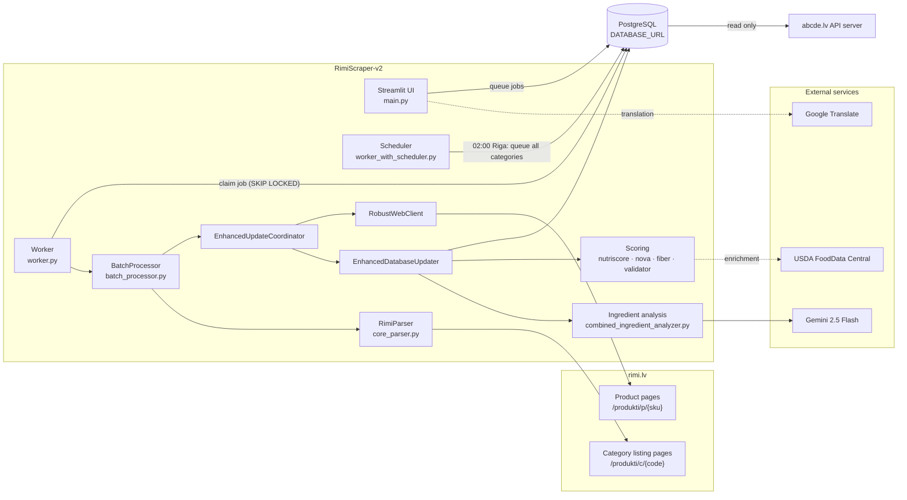
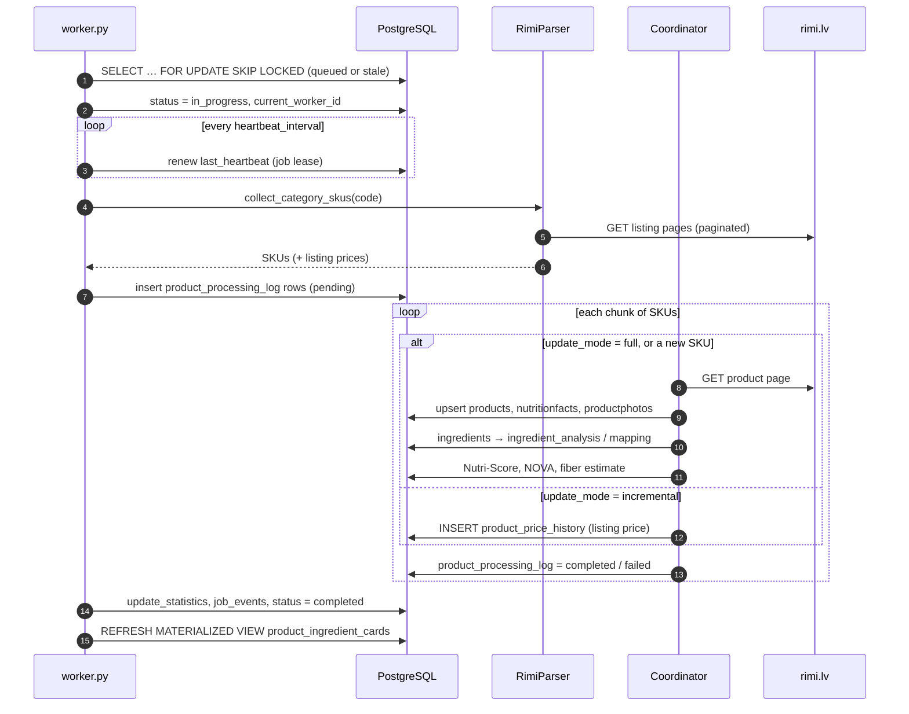
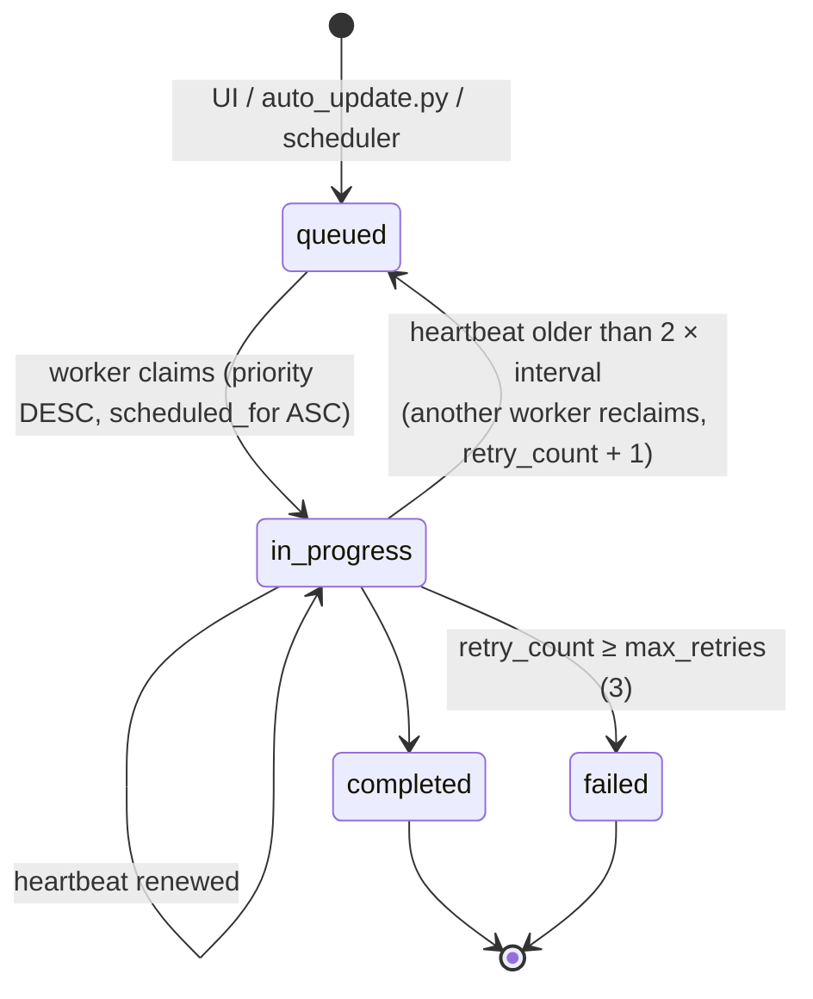
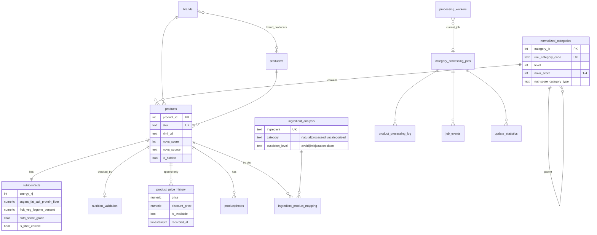
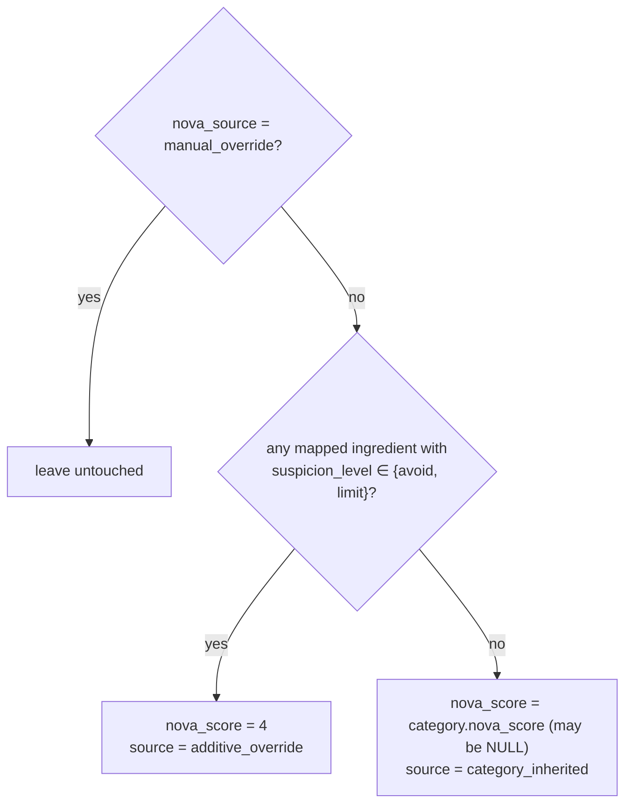
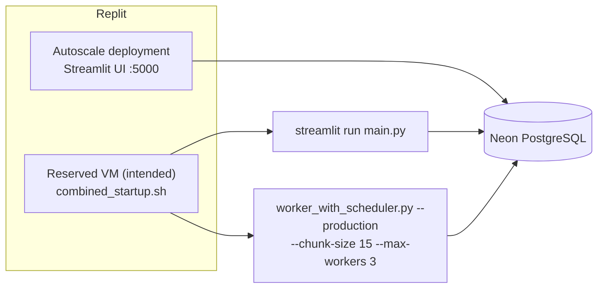

# RimiScraper-v2 Architecture

RimiScraper-v2 collects product data from the Rimi Latvia online store (`www.rimi.lv/e-veikals`), scores it and stores it in PostgreSQL. The [abcde.lv](https://abcde.lv) website reads this database directly. Its connection string is the website's `RIMI_DATABASE_URL`.

## Components

| Layer | Modules | Responsibility |
|---|---|---|
| UI | `main.py`, `product_view_db.py` | Product browser, job queue control, NOVA and Nutri-Score category settings, nutrition editing, enrichment, change reports, worker health |
| Orchestration | `worker.py`, `worker_with_scheduler.py`, `auto_update.py`, `combined_startup.sh` | Job queue, heartbeats, scheduling, process supervision |
| Scraping | `core_parser.py`, `robust_web_client.py` | Category pagination, SKU collection, listing-page prices, product pages with retries |
| Persistence | `enhanced_update_coordinator.py`, `enhanced_database_updater.py`, `smart_updater.py`, `progress_manager.py` | Create or update products, diff against stored values, per-SKU progress |
| Enrichment | `nutriscore_calculator.py`, `nova_calculator.py`, `fiber_estimator.py`, `usda_enrichment.py`, `nutrition_validator.py`, `combined_ingredient_analyzer.py`, `brand_producer.py` | Derived scores and data quality |

## Processing pipeline

A job is one Rimi category, such as `SH-11-9-26`. The worker collects the category's SKUs, splits them into chunks of 15 by default, and processes each chunk with a thread pool of 3 by default.

There are two update modes:

- **Full** visits every product page and refreshes everything: ingredients, nutrition, photos and price.
- **Incremental** reads prices from category listing pages, which is 10–50× faster. It only opens product pages for SKUs that aren't in the database yet. The daily scheduled run uses this mode.

A second job type, `suspicious_refresh` (`suspicious_refresh.py`), re-scrapes products that the nutrition validator flagged. It moves through the phases `queued → scraping → validating → completed`.

### Job lifecycle

A worker owns a job only while its lease is valid. The lease lasts $2 \times$ `heartbeat_interval`, which is 60 s at the default of 30 s. After that, any worker can reclaim the job. `_ensure_refresh_job_ownership` stops the old worker from writing progress after it has lost the lease.

## Data model

These rules are kept throughout the code:

- **Prices are append-only.** `products` has no price or availability columns. A change inserts a new row into `product_price_history`. The current price is the latest row, which queries fetch with a `LATERAL` join.
- **Manual edits win.** Scoring jobs never overwrite `nova_source = 'manual_override'`, `nutrition_manual_edit = TRUE` or the `*_explicit` flags on a category.
- **`product_ingredient_cards`** is a materialized view with a unique index on `sku`. It exposes each product's ingredient analysis to other projects. The worker refreshes it after each job.
- The schema is in `schema.sql`, plus `migrations/001…006`.

## Scoring

### Nutri-Score 2024 (`nutriscore_calculator.py`)

Every nutrient is scored with the same step function. For a value $x$ per 100 g or 100 ml and an ascending threshold list $T = (t_0, \dots, t_{k-1})$:

$$
\operatorname{pts}(x, T) = \bigl|\{\, i : x > t_i \,\}\bigr| \in \{0, \dots, k\}
$$

The negative and positive totals are:

$$
N = \operatorname{pts}(E) + \operatorname{pts}(\text{sugars}) + \operatorname{pts}(\text{sat.\ fat}) + \operatorname{pts}(\text{salt}) \;\bigl[+\,4 \text{ if sweetened beverage}\bigr]
$$

$$
P = \operatorname{pts}(\text{protein}) + \operatorname{pts}(\text{fiber}) + \operatorname{pts}_{\text{FVL}}
$$

The final score $S$ is:

$$
S =
\begin{cases}
N - (\operatorname{pts}(\text{fiber}) + \operatorname{pts}_{\text{FVL}}) & \text{if category} \notin \{\text{cheese}, \text{beverage}\},\ N \ge 11,\ \operatorname{pts}_{\text{FVL}} < 5 \\[4pt]
N - P & \text{otherwise}
\end{cases}
$$

In the first case protein is left out.

Each category has its own rules:

| Category (`nutriscore_category_type`) | Specific rules |
|---|---|
| `general`, `full_fvn` (FVL = 100 %), `half_fvn` (FVL = 50 %) | Energy thresholds in steps of 335 kJ. FVL points are 0, 1, 2 or 5 at the 40, 60 and 80 % cut-offs. |
| `red_meat` | Protein points are capped at 2. |
| `cheese` | Protein always counts. |
| `fat_oil_nut` | Energy is replaced by energy from saturated fat ($37 \cdot \text{sat.\ fat}$, in steps of 120 kJ). Saturated fat is replaced by the ratio $100 \cdot \text{sat.\ fat} / \text{fat}$. |
| `beverage` | Separate energy and sugar thresholds. +4 if `LATVIAN_SWEETENER_INDICATORS` match. FVL points are 0, 2, 4 or 6. |

The score maps to a grade as follows:

| Grade | General / cheese / red meat | Fats, oils, nuts | Beverages |
|---|---|---|---|
| A | $S \le -1$ | $S \le -6$ | $E = 0$ and sugars $= 0$ and no sweetener |
| B | $S \le 2$ | $S \le 2$ | $S \le 2$ |
| C | $S \le 10$ | $S \le 10$ | $S \le 6$ |
| D | $S \le 18$ | $S \le 18$ | $S \le 9$ |
| E | otherwise | otherwise | otherwise |

> **Worth checking:** in the published 2023/2024 table as I understand it, grade A for general foods covers scores $\le 0$, not $\le -1$. Fats, oils and nuts drop the protein rule at $N \ge 7$, not $N \ge 11$. Compare the code against the official specification before relying on borderline grades.

### NOVA (`nova_calculator.py`)

Each product gets a NOVA processing group in two passes:

### Fiber estimation (`fiber_estimator.py`)

Rimi often doesn't publish fiber, so Nutri-Score would undercount fiber points. The estimator fills it in this order:

1. Use the scraped or USDA fiber if it is greater than 0.
2. Otherwise, use a keyword exception rule that matches the product name.
3. Otherwise, use the category default from `CATEGORY_FIBER_DEFAULTS`.

Estimated values keep `is_fiber_correct = FALSE`. Nutri-Score is recalculated afterwards.

### Nutrition validation (`nutrition_validator.py`)

The validator checks that the ingredients agree with the nutrition table. It flags three cases:

- sugar is an ingredient but sugars = 0
- salt is an ingredient but salt = 0
- dairy is an ingredient but saturated fat = 0

Each finding has weight $w = 8$. The validator adds up the weights of the findings and assigns a level from the total $s$:

$$
\text{level}(s) =
\begin{cases}
\text{none} & s \le 0 \\
\text{low} & s \le 4 \\
\text{medium} & s \le 9 \\
\text{high} & s > 9
\end{cases}
$$

So one finding is *medium* and two or more are *high*. The results go to `nutrition_validation` and feed the `suspicious_refresh` jobs.

### Ingredient analysis (`combined_ingredient_analyzer.py`)

Ingredient lists are normalized and deduplicated by `ingredient_processor.py` and `ingredient_deduplicator.py`. Each unique ingredient is stored once in `ingredient_analysis`. One Gemini 2.5 Flash call per batch classifies each ingredient:

- **category:** natural, processed or uncategorized
- **suspicion level:** avoid, limit, caution or clean
- **health note**

E-numbers are found with a regular expression before the AI step.

## Deployment

`combined_startup.sh` supervises both processes. It restarts them with exponential backoff, from 30 s up to 600 s. After 5 crashes within 5 minutes it pauses for 30 minutes. Until the Reserved VM is available, the worker runs on Autoscale with `--chunk-size 3 --max-workers 1` to fit Autoscale's 90-second timeout for background work. `RESERVED_VM_SETUP.md` has the details.

## Notes

- `openai` is listed in `pyproject.toml` but no module imports it. All AI calls go through `google-genai`.
- The top level contains many one-off `debug_*`, `fix_*` and `test_*` scripts tied to specific SKUs. Retired modules are in `archive/`.
